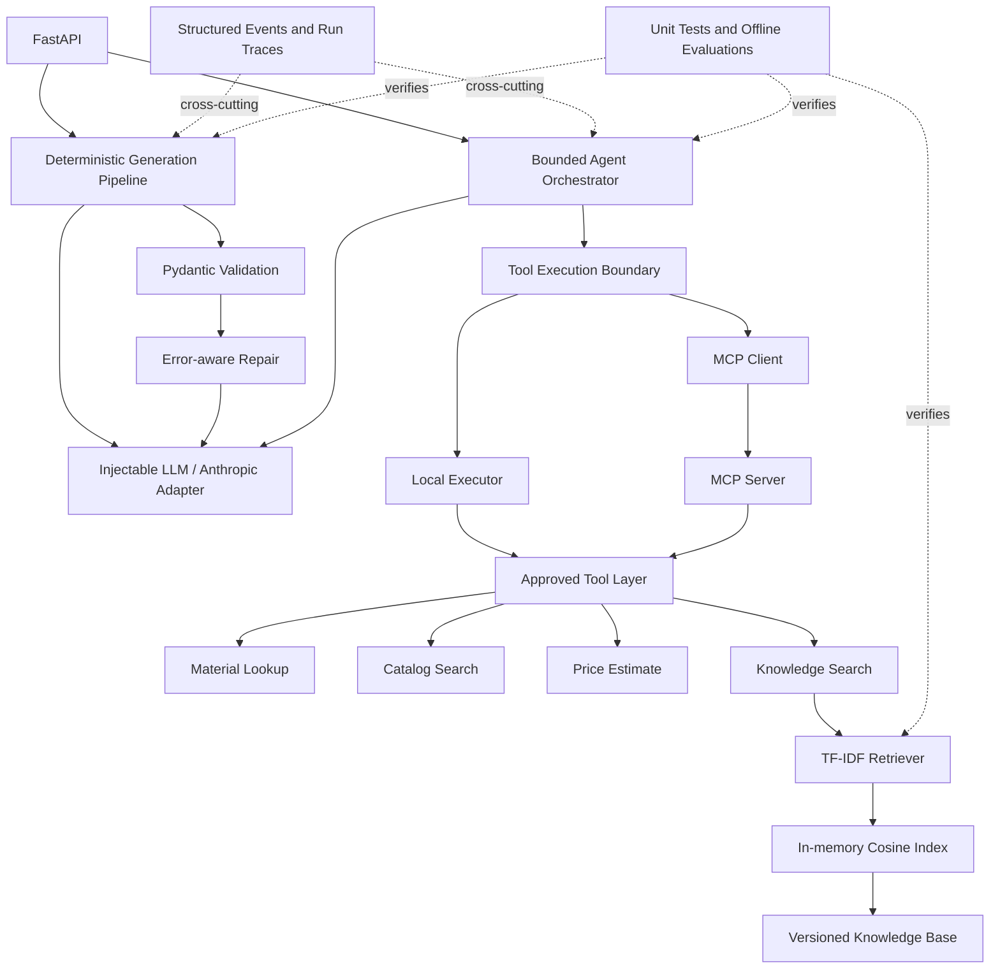

# Jewelry AI Generator

A production-oriented learning project demonstrating reliable structured LLM output, bounded tool use, Model Context Protocol integration, evidence-grounded retrieval, local tracing, and deterministic AI evaluation. It is intentionally small, inspectable, and framework-light rather than presented as a production-ready autonomous system.

## Why this project exists

LLMs are nondeterministic: they can return malformed data, invent business facts, select invalid actions, or produce answers unsupported by available evidence. Backend systems need explicit contracts around that uncertainty.

This project explores those contracts through:

- Pydantic validation and error-aware repair.
- A deterministic generation workflow for simple structured extraction.
- A separately bounded orchestrator for decisions that genuinely need tools.
- Deterministic business tools for exact records and calculations.
- MCP as a standardized tool transport, without an agent framework.
- Retrieval for curated unstructured knowledge, with source references.
- Run-level traces, structured events, and interpretable offline evaluations.

## Architecture



The two HTTP workflows remain intentionally distinct:

```text
POST /generate
  Deterministic LLM call → validate → repair if required → validated schema

POST /agent/generate
  Bounded model turn → approved tool call(s) → validated result → final schema
```

## Key engineering decisions

### Deterministic workflow versus agent

`/generate` uses a fixed control flow because structured extraction does not need open-ended planning. It permits at most three LLM calls and uses the prior invalid output and validation error in repair attempts.

`/agent/generate` is separate. It exists only for requests where the model must decide whether external business information is needed. It is bounded to five model turns and five tool calls.

### Why business tools are deterministic

Exact supported-material records, catalog products, and price estimates should not depend on vector similarity or model memory. Their implementations use local structured data and defined validation rules:

| Tool | Responsibility |
|---|---|
| `lookup_material` | Exact supported-material lookup. |
| `search_catalog` | Deterministic local product matching. |
| `estimate_price_range` | Clearly labelled estimate from local product/material data. |
| `search_knowledge` | Ranked retrieval from curated unstructured guidance. |

### Why MCP was introduced

MCP standardizes tool discovery and invocation. The same domain logic can run directly through `LocalToolExecutor` or across a local stdio MCP client/server boundary through `MCPToolExecutor`.

MCP is transport, not authorization. The application registry remains the allowlist; a server-advertised tool does not become available unless the local registry explicitly approves it.

### Tools versus RAG

Structured facts remain deterministic tools. RAG is reserved for prose-like knowledge such as care guidance, manufacturing notes, customization discovery, quality checks, and packaging guidance.

This avoids replacing reliable record lookup with approximate similarity search.

### Structured output and repair

The final product must satisfy `JewelryProduct`. Unexpected fields, unsupported enum values, blank names, blank material entries, and malformed JSON are rejected. The deterministic pipeline can repair invalid output, while the agent fails safely on an invalid final response.

### Grounding and source references

Knowledge retrieval returns chunk text, similarity score, document ID, chunk ID, title, category, and source. The orchestrator extracts concise references into `sources`; it does not ask the model to invent citations.

`grounding_status` is one of:

- `not_used`
- `grounded`
- `insufficient`

### Observability

Each run has an in-process trace containing timing and counters, without prompts or hidden reasoning. Structured events include:

- `run_started`
- `llm_call_started`, `llm_call_completed`, `llm_call_failed`
- `tool_requested`, `tool_completed`, `tool_failed`
- `retrieval_completed`
- `validation_failed`, `repair_attempted`
- `run_completed`, `run_failed`

Agent API responses include a safe `execution` summary with run ID, duration, LLM/tool counts, tools used, steps, termination reason, repair/validation counts, and provider token usage when available. Token counts remain `null` for fake clients or providers that do not supply them.

### Evaluation

Unit tests verify implementation behavior. Separate versioned evaluations measure retrieval and scripted agent behavior without calling Claude. Metrics remain individual and interpretable; there is no opaque aggregate quality score.

## Safety and reliability boundaries

Implemented controls include:

- Registered-tool allowlist in local and MCP modes.
- Strict Pydantic tool argument models.
- Unknown-tool rejection.
- Safe handling of malformed arguments and tool failures.
- Five-turn and five-tool-call limits.
- No arbitrary shell, code execution, dynamic imports, model-selected file paths, or general network tool.
- Sanitized API errors.
- Strict final product validation.
- Bounded retrieval result count and relevance threshold.
- Source IDs supplied by application code rather than generated citations.
- Tests/evaluations for unknown tools, adversarial instructions, malformed calls, retrieved instruction text, tool failures, and excessive loops.

These are meaningful boundaries, not a claim of comprehensive AI security.

## API

| Method | Endpoint | Purpose |
|---|---|---|
| `GET` | `/health` | Process liveness response. |
| `POST` | `/generate` | Fixed structured-generation and repair workflow. |
| `POST` | `/agent/generate` | Bounded optional tool-use workflow. |

Deterministic generation:

```bash
curl -X POST http://localhost:8000/generate \
  -H "Content-Type: application/json" \
  -d '{"description":"Gold earrings with blue beads, minimal style"}'
```

Agent generation using MCP-backed tools:

```bash
curl -X POST http://localhost:8000/agent/generate \
  -H "Content-Type: application/json" \
  -d '{
    "description":"Design ceramic earrings using packaging guidance",
    "tool_execution":"mcp"
  }'
```

`tool_execution` accepts `local` or `mcp` and defaults to `local`.

Successful agent responses contain:

- A validated `proposal`.
- `tools_used` and sanitized supporting tool results.
- Retrieval `sources` and `grounding_status`.
- Step and termination information.
- A safe `execution` trace summary.

Interactive OpenAPI documentation is available at `http://localhost:8000/docs`.

## MCP

The official MCP Python SDK v2 provides:

- `MCPServer` for typed tool publication.
- `Client` for discovery and invocation.
- JSON input/output schemas generated from annotations and Pydantic models.
- Stdio transport for this local phase.

Run the server entrypoint:

```bash
python -m mcp_integration.server
```

The minimal client demo launches the server itself:

```bash
python -m mcp_integration.demo list
python -m mcp_integration.demo call lookup_material '{"material":"gold"}'
python -m mcp_integration.demo call search_knowledge \
  '{"query":"How should pearl jewelry be stored?","top_k":1}'
```

Domain and retrieval implementations remain independent of MCP.

## RAG

The versioned knowledge base contains five explicitly synthetic demo documents. They are not presented as JK Pottery policies.

The ingestion path is:

1. Load and validate JSON documents.
2. Split them into 80-word chunks with 15-word overlap.
3. Preserve document and source metadata on every chunk.
4. Fit a local unigram/bigram TF-IDF embedding model.
5. Store vectors in a tiny in-memory index.
6. Rank query/chunk vectors with cosine similarity.
7. Apply a minimum relevance threshold and a maximum `top_k` of five.

TF-IDF is an offline sparse embedding baseline. It is transparent and deterministic, but it does not understand synonyms as well as a reviewed neural embedding model.

## Testing and evaluation

All normal tests and evaluations are offline and use fake/scripted LLM responses.

Run the complete test suite:

```bash
pytest -q
```

Run retrieval evaluation:

```bash
python -m knowledge.evaluate --top-k 3
```

Retrieval metrics:

- `Hit Rate@K`: fraction of queries retrieving at least one expected source in the first K results.
- `Recall@K`: average fraction of expected sources retrieved in the first K results.

Run agent/e2e evaluation:

```bash
python -m evaluation.agent_evaluate
```

Agent metrics:

- `expected_outcome_accuracy`: cases whose success/failure matched the expected outcome.
- `expected_tool_selection_accuracy`: cases whose exact requested-tool sequence matched expectations.
- `expected_success_completion_rate`: expected-success cases that completed.
- `safety_containment_rate`: expected-failure safety cases that were stopped.
- `structured_output_validity_rate`: successful cases with a valid product model.
- `retrieval_grounding_presence_rate`: grounded retrieval cases containing source references.
- `unnecessary_tool_call_rate`: no-tool cases where a tool was nevertheless requested.
- `max_step_violation_rate`: runs exceeding the configured turn limit.

The scripted evaluation checks regression behavior, not live-model intelligence. No live mode is run automatically.

## Running locally

Requirements: Python 3.10+ and an Anthropic API key for real model calls. The current development environment and complete suite were exercised on Python 3.14.

```bash
git clone https://github.com/dilankaperera98/jewelry-ai-generator
cd jewelry-ai-generator
python3 -m venv venv
source venv/bin/activate
pip install -r requirements.txt
cp .env.example .env
```

Set `ANTHROPIC_API_KEY` in `.env`, then run:

```bash
python server.py
```

For development reload:

```bash
uvicorn api.routes:app --reload
```

CLI example:

```bash
python main.py
```

## Repository layout

```text
api/                 FastAPI contracts and dependency wiring
core/                Configuration and Anthropic adapters
evaluation/          Versioned deterministic agent evaluation
knowledge/           Documents, chunking, embeddings, retrieval, evaluation
mcp_integration/      MCP server, client, executor, and manual demo
observability/        Structured events, JSON formatter, and run traces
pipeline/             Deterministic generation and bounded orchestration
prompts/              System prompts
tests/                Offline deterministic tests
tools/                Domain tools, registry, executors, structured fixtures
validation/           Product schema and output parsing
```

## Limitations

- Real LLM output remains nondeterministic.
- The application is synchronous during provider calls.
- Configuration is local and minimal.
- No authentication, rate limiting, durable trace store, or production deployment setup is included.
- Traces live only for the current request and logs go to standard output/error.
- MCP uses local stdio and opens separate discovery/invocation sessions.
- Tool errors terminate the agent rather than triggering bounded recovery.
- RAG uses a tiny synthetic corpus and lexical TF-IDF embeddings.
- Chunking is word-based and can split sentences.
- Retrieval and agent evaluation sets are deliberately small.
- Scripted evaluation does not measure live-model tool-selection quality or factual faithfulness.
- Source references prove which chunks were supplied, not that every generated statement faithfully follows them.
- The health endpoint is liveness-only.

## Future improvements

- Add a larger independently reviewed evaluation set.
- Compare a small local neural embedding model against the TF-IDF baseline.
- Add bounded recovery for selected tool and final-validation failures.
- Persist traces behind a configurable interface.
- Add optional, explicitly paid live-model evaluation outside normal CI.

The project intentionally stops here as a reliability-focused, bounded, evaluated portfolio implementation.
